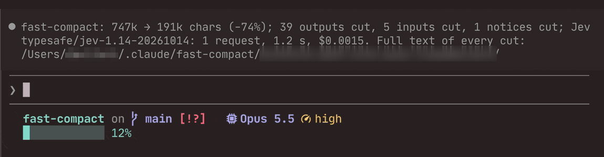
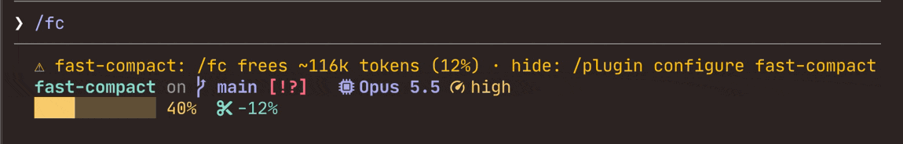

# fast-compact

**Free up Claude Code's context in about a second, without summarising anything away.**



`/fc` (or `/fast-compact`) cuts old tool output (file reads, logs, test runs Claude has already used) down to its start and end. Every cut is saved to a file Claude can read back. Optionally, Jev, a fast decision model, picks which outputs to keep whole. Claude Code's own `/compact` stays exactly as it is: use `/fc` as you go, and `/compact` when the conversation itself needs summarising.

- **About a second**, not the minute or more a summary takes, so you can run it as often as you like
- **Nothing is lost**: each cut names the file holding the full text, and Claude reads it when it needs to
- **Shows you when it's worth running**: a line under the prompt says how much `/fc` would free right now
- **No key needed**: with Jev, it keeps slightly more of what matters; without it, nothing leaves your machine

**How much it frees depends on the session.** `/fc` only shrinks tool output and long tool inputs, never what you or Claude wrote. A session full of file reads, logs and test runs can drop by a third or more in one go; one that's mostly discussion may free almost nothing, and then `/compact` is the right tool. The meter tells you which kind of session you're in before you run it.

## Quick start

```sh
claude plugin marketplace add NodarDavituri/fast-compact
claude plugin install fast-compact@fast-compact
```

Turn on function hooks (`"CLAUDE_CODE_ENABLE_FUNCTION_HOOKS": "1"` under `env` in `~/.claude/settings.json`), restart Claude Code, and type `/fc`. To let Jev choose what stays whole, add a key ([Install](#install)).



What a run reports:

```
❯ /fc
  ⎿  fast-compact: compacting…
❯ /compact [fast-compact]
  ⎿  Compacted
⏺ fast-compact: 103k → 81k chars (−21%); 4 outputs cut; Jev typesafe/jev-1.13-20260917: 1 request, 0.6 s, $0.0002.
  Full text of every cut: ~/.claude/fast-compact/<session>/
```

## How it works

1. **Recent work is left alone.** The newest 10 tool calls, and everything you or Claude wrote, stay as they are.
2. **Jev picks what to keep.** Older outputs longer than about 2,000 characters are ranked by Jev. The ones it rates as still needed stay whole (up to a quarter of the old output).
3. **The rest is cut to its start and end.** Each keeps its first 1,000 and last 500 characters, with a marker in the middle:
   `[fast-compact: cut 5707 chars from the middle of this output; the full text is in ~/.claude/fast-compact/<session>/output-<id>.txt — read it before relying on what was cut]`
4. **Nothing is lost.** The full text is saved before anything is cut. When Claude needs a cut detail, it reads the file — in testing it did exactly that, with one grep.
5. **Long old inputs are trimmed too** — Bash scripts, file bodies written with Write, Edit strings — and old reminders and notices keep their first 300 characters. No tool call is ever removed.

If Jev can't be reached, or no key is set, the newest outputs are kept whole instead and the report says why. `/fc` never falls back to Claude Code's slow built-in summary.

**Jev is optional.** Without it, `/fc` keeps the newest old outputs whole instead of Jev's picks. In the replay below that keeps 73% of later-needed outputs usable instead of 75%, and frees a little less, but nothing leaves your machine and there's no key to set. Leave the key unset, or set `provider` to `none` to skip Jev even when a key is in your environment.

Add a focus if you like: `/fc keep the migration plan`.

## Why this and not fast-jev-compaction

[fast-jev-compaction](https://github.com/tamaratran/fast-jev-compaction) by tamaratran had the idea: cheap Jev decisions instead of a slow summary. fast-compact started from it, measured it on real sessions, and changed what didn't hold up.

| | fast-jev-compaction | fast-compact |
|---|---|---|
| How you run it | Takes over `/compact` and auto-compaction | Its own `/fc`; `/compact` is untouched |
| Old tool calls | Almost all deleted (98% in our replay), output and all | Never deleted; long output is cut to its start and end |
| A needed detail gets cut | Gone | Saved to a file; Claude reads it back |
| Can't free enough | Falls back to the slow built-in summary | Never summarises; says why |
| After `--resume` | The full old history comes back | Stays compacted |
| Jev provider | TypeSafe only — its firewall blocks many real sessions | OpenRouter (default) or TypeSafe |

Deleting calls also caused a subtler problem: Claude's own notes about the deleted work stayed behind without the calls, and one session went on to report nine pieces of work it had never done ([upstream #65](https://github.com/tamaratran/fast-jev-compaction/issues/65)). fast-compact keeps every call, and every cut says where its full text is.

### The numbers

We replayed 122 moments from 59 real Claude Code sessions and checked which tool output each session actually used afterwards. (Method and every number: [bench/](bench/).)

| How old output was handled | Output kept | Later-needed outputs that stayed usable |
|---|---|---|
| **fast-compact** — Jev picks what stays whole | 57% | **75%** |
| Every output cut to start and end, same size | 57% | 69% |
| The newest outputs stay whole, no Jev | 61% | 73% |
| fast-jev-compaction as shipped | 0% | 1% |

*An output counts as usable when the detail the session later relied on survived the cut.*

Four model reviewers also judged 100 outputs blind. Jev's ranking agreed with them more than ranking by size, by recency, or by the original plugin's scoring. The reviewers also found that about 40% of needed outputs had the useful part in the middle or spread throughout — which no start-and-end cut keeps. That's why every cut is saved to disk.

## Install

You need:

- Claude Code with function hooks turned on — an early-access plugin feature (built on 2.1.283, tested on 2.1.283, 2.1.296 and 2.1.300).
- Optionally, a key for Jev: an [OpenRouter](https://openrouter.ai) key (default), or a [TypeSafe](https://console.typesafe.ai/keys) key. Without one, `/fc` still works ([above](#how-it-works)).

Turn on function hooks in `~/.claude/settings.json`, and add the key there too if you have one:

```json
{ "env": { "CLAUDE_CODE_ENABLE_FUNCTION_HOOKS": "1", "OPENROUTER_API_KEY": "sk-or-…" } }
```

Install the plugin:

```sh
claude plugin marketplace add NodarDavituri/fast-compact
claude plugin install fast-compact@fast-compact
```

Restart Claude Code (or run `/reload-plugins`) and type `/fc`. The installer mentions options "not yet set" — that's fine: the defaults below apply until you change them.

You can also keep the key in the plugin's own `apiKey` option (`/plugin configure fast-compact`); Claude Code stores it securely.

### Updates

Claude Code doesn't update plugins from this marketplace on its own unless you turn it on: run `/plugin`, open the **Marketplaces** tab, select fast-compact and choose **Enable auto-update**. New versions are then installed in the background and load in your next session.

To update by hand:

```sh
claude plugin marketplace update fast-compact
claude plugin update fast-compact@fast-compact
```

Then restart Claude Code or run `/reload-plugins`. What changed in each version, and anything you need to do, is in [CHANGELOG.md](CHANGELOG.md).

## Options

Change them with `/plugin configure fast-compact`, or in `settings.json` under `pluginConfigs["fast-compact@fast-compact"].options`.

| Option | Default | What it does |
|---|---|---|
| `provider` | `openrouter` | `openrouter` (key in `OPENROUTER_API_KEY`), `typesafe` (`TYPESAFE_API_KEY`), or `none`: never ask Jev. Any other value counts as `none` |
| `apiKey` | — | The key, instead of the environment |
| `baseUrl` | the provider's | Another System One endpoint |
| `model` | `jev-latest` | Model name sent to Jev |
| `keepRecentCalls` | `10` | How many of the newest tool calls are never cut |
| `cutTo` | `1500` | Characters a cut keeps: two thirds from the start, one third from the end |
| `keepWhole` | `0.25` | Largest share of old output Jev may keep whole |
| `minKeepScore` | `0.45` | Jev's lowest score for keeping an output whole |
| `cutInputs` | `true` | Also trim long old tool inputs |
| `sendSamples` | `true` | Show Jev the first 200 and last 100 characters of each output it ranks |
| `resumeSafe` | `true` | Keep the compaction when you `--resume` the session |
| `autoCompact` | `false` | Cut instead of summarising when Claude Code compacts on its own ([below](#auto-compaction)) |
| `meter` | `prompt` | Show what `/fc` would free: `prompt`, `statusline`, `both` or `off` ([below](#see-what-fc-would-free)) |

## Auto-compaction

With `autoCompact` on, Claude Code's own auto-compaction gets the `/fc` treatment: old tool output is cut, Jev keeps what's still needed, every cut is saved to a file. It takes about a second instead of a minute or more, and nothing is summarised away.

When the cut would free less than a fifth of the conversation, Claude Code summarises as usual: with less, the context would stay near its limit and compact again a few turns later. The same happens if anything goes wrong. `/compact`, subagents and Claude Code's background precompute are never touched.

Each run adds a ledger line with `"trigger":"auto"`.

## See what /fc would free

`meter` works out after each turn what `/fc` would free right now. It runs the same cut with the newest outputs kept whole instead of asking Jev, so it sends nothing anywhere and takes a few milliseconds.

`/fc` usually frees more than the meter says. Jev keeps whole only what it rates as still needed, often less than the meter assumes, and the compaction also drops Claude's hidden reasoning from older messages (with `resumeSafe`, the default), which the meter can't see. In one session the meter said 12% and the context went from 40% to 12%.

- `prompt` (the default) pins a line under the prompt: `/fc frees ~30k tokens (3%) · hide: /plugin configure fast-compact → meter`, the percentage being the share of the context window; the hint is dropped after the first three lines of a session. It appears at the end of a turn once there's at least 2k tokens to free in outputs older than the newest `keepRecentCalls` (10) tool calls, and clears when the conversation is compacted.
- `statusline` writes the token count to `~/.claude/fast-compact/meter/<session id>` (empty when there's less than 2k to free, and right after a compaction), for your [status line](https://code.claude.com/docs/en/statusline) command to read.
- `both` does both, and `off` shows nothing.

This shows it as the share of the context window `/fc` would free — `/fc −3%` with 11% used means `/fc` would take you to about 8%:

```sh
input=$(cat)
freed=$(cat "$HOME/.claude/fast-compact/meter/$(echo "$input" | jq -r .session_id)" 2>/dev/null)
size=$(echo "$input" | jq -r '.context_window.context_window_size // 0')
if [ -n "$freed" ] && [ "$size" -gt 0 ]; then
  pct=$(( (freed * 100 + size / 2) / size ))
  if [ "$pct" -gt 0 ]; then printf '/fc −%s%%' "$pct"; fi
fi
```

Or, in tokens: `[ -n "$freed" ] && printf '/fc −%sk' $((freed / 1000))`.

## Privacy: what leaves your machine

**Sent to Jev, each time you run `/fc` (and on auto-compaction, with `autoCompact` on):**

- your and Claude's messages (long ones shortened)
- tool inputs (shortened)
- a one-line note for each tool output
- with `sendSamples`: the first 200 and last 100 characters of each output Jev ranks

With the default provider, this goes to Jev through OpenRouter. After an earlier `/fc`, the markers in cut tool inputs name their archive file, so what's sent includes your home folder's path and the session id.

Secrets that look like keys, tokens, passwords, private keys or URLs with passwords are masked before sending. The masking works by pattern, so treat it as a safety net, not a guarantee. With no key set, or `provider` set to `none`, nothing is sent.

**Kept on your machine:**

- the full text of every cut, in `~/.claude/fast-compact/<session>/` — next to where Claude Code already keeps your transcripts
- one line per `/fc` (sizes, counts, cost) in `~/.claude/fast-compact/ledger-<year>-<month>.jsonl`
- with `meter` set to `statusline` or `both`, one small file per session in `~/.claude/fast-compact/meter/`

Nothing is deleted automatically. To clear sessions older than a month:

```sh
find ~/.claude/fast-compact -mindepth 1 -maxdepth 1 -type d -mtime +30 -exec rm -r {} +
```

## Limits

- **Early-access feature.** Function hooks can change with any Claude Code update. If `/fc` stops working, run `claude plugin validate` and check a `--debug-file` log for the plugin's `hooks module … loaded` line.
- **You'll see `/compact [fast-compact]` in the transcript.** Claude Code doesn't let a plugin run a compaction from its own command, so `/fc` runs the built-in `/compact` with a marker and answers it itself. Any `/compact` whose instructions start with `[fast-compact]` is handled by this plugin — including one you type yourself.
- **It only shrinks tool output, tool input and notices.** If your conversation is mostly text, use `/compact`.
- **Not on a Claude Code an organization manages,** unless the organization lists this plugin in its managed settings: there, plugins you install yourself get no compaction hooks, so the `/compact` that `/fc` schedules runs Claude Code's own summary. fast-compact notices this the first time, says so, and turns `/fc` and the meter off for that session.
- **`resumeSafe` has a small cost:** older messages lose Claude's hidden reasoning, and a message that held only an image is dropped. Text and tool calls stay.
- **With `autoCompact`, the spinner can get stuck.** In Claude Code 2.1.296, after a plugin answers an auto-compaction, the spinner says "Running SessionStart hooks…" until the turn ends. Claude keeps working underneath; let the turn finish rather than pressing Esc.
- **Jev gets up to 6 seconds per request.** If it's slower or silent, that run keeps the newest outputs whole instead.
- **Sizes are counted in characters,** not tokens.
- **The measurements come from one person's sessions.** Run the bench on your own: `bun bench/run.ts --jev`.

## Development

```sh
bun install
bun run typecheck
bun run test         # core tests, plus the plugin in Claude Code's own test host
bun run validate
```

- `src/` — the logic (no Node APIs and no dependencies: hooks run in their own environment)
- `hooks/fast-compact.ts` — the Claude Code side
- `tests/core`, `tests/plugin` — the tests
- `.claude-plugin/types/` — Claude Code's plugin API types, which Claude Code writes when a session loads this folder as a plugin (gitignored; the typecheck reads them)
- `bench/` — the replay bench behind the numbers above
- `docs/design.md` — why it works this way, what was turned down, and what's still open

## Credits

Built on [tamaratran/fast-jev-compaction](https://github.com/tamaratran/fast-jev-compaction) (MIT): the idea, the way the conversation is fitted into Jev's input (`src/state.ts`), and the original library, kept in `bench/upstream/` so the bench can measure it. Its unmerged `bash-output-trim` branch was the first to save cut output to a file.

ggagosh contributed the `autoCompact` and `meter` options and the fix for parallel tool calls after a compaction (#1).

Issues and pull requests on that repository shaped this one:

- measuring the scoring: #26 (yelban), #52 (grigorelipcanu, Austin666k, JYeswak), #56 (0xsline), #57 (u2giants), #99 (Dymyt-ry)
- invented reports and host text: #65, #77, #78 (orangewk)
- keeping calls: #67 (hyofeng), #83 (grahamfarrar)
- token estimates: #81 (davekim917), #85 (kuishou68)
- resume: #89 (federicodeponte), #98 (socialadsmentor)
- the firewall: #97 (grixu)
- no summary fallback: #103 (XavierXIEXIN)
- samples inside questions: #105 (prasannaJosium)
- which compactions to touch: #107 (jayjeo)
- a separate command: #20 (Manojbhat09)

## License

MIT
